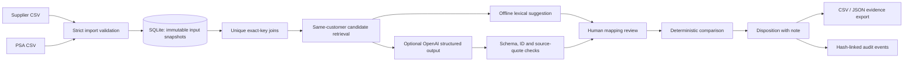

# Architecture

## Data flow

## Modules

- `lib/core.mjs`: strict CSV parsing, canonical input validation, integer-cent arithmetic, one-to-one mapping, comparability gates, decisions and exports.
- `lib/matching.mjs`: lexical candidate retrieval, explicit abstention, edition guards, optional Responses API call, evidence validation, failure traces and cost estimates.
- `lib/store.mjs`: transactional SQLite persistence, tenant scoping, passwords, sessions, optimistic version checks and audit hashes.
- `server.mjs`: bounded JSON API, static allowlist, authentication/authorization, origin/CSRF checks and request limits.
- `public/app.js`: task-focused browser interface; no dependencies, credentials or secrets in localStorage.
- `public/research*`: static interactive research dossier. Contains public research only.

## Persistence model

Organizations own users and runs. Sessions contain a hash of a random bearer token, a CSRF token and an eight-hour expiry. Runs store immutable original CSV strings, parsed rows, approved mappings, suggestions, decisions, traces and a monotonically increasing version. Exact source hashes produce an organization-scoped idempotency key. Audit events chain within an organization; exports include the organization's history so the chain is verifiable. Run data and audit insertion share a transaction.

An expensive model request runs outside a database transaction. Its result is saved only if the original run version still matches. A concurrent decision can cause the result to be discarded; this is preferable to saving a stale suggestion. Provider usage after such a conflict may not be captured in the current local trace record, so provider billing remains authoritative. No retries or autonomous tool loops.

## Why this stack

A small local tool does not require multiple services or an external identity/database vendor. Native Node 24 SQLite avoids installation and keeps the demonstration reproducible offline. Browser modules keep the UI inspectable. Tradeoffs: Node 24 runtime requirement, synchronous DB/password work on one process, custom HTTP routing, limited frontend modularity and no horizontal scaling. Moving to SaaS is an architectural project, not a switch in the hosting config.

## Deployment and operations

Normal server binds 127.0.0.1 by default. Demo separately enforces loopback and disables AI. Docker Compose binds its published port to loopback; the internal service binds all container interfaces and runs as the `node` user. Named volume retains SQLite. Only one process should use the application's local file store operationally. Docker and CI configuration are supplied but unexecuted.

For a local backup, stop the server cleanly, then copy the entire `data` directory to protected storage; do not copy only the main DB while WAL writes are active. Restore into the same app version and verify a known review plus the audit chain. Automated backup/restore drills, migrations, retention policies and remote log collection are not implemented.

Future hosted architecture: TLS reverse proxy with exact PUBLIC_ORIGIN, private process/network, managed identity with MFA/revocation, Postgres row-level isolation or independently reviewed tenant checks, encrypted managed storage and backups, request/cost monitoring, tested restore/migrations, incident handling and deletion/export policies. No such hosted configuration has been deployed.
