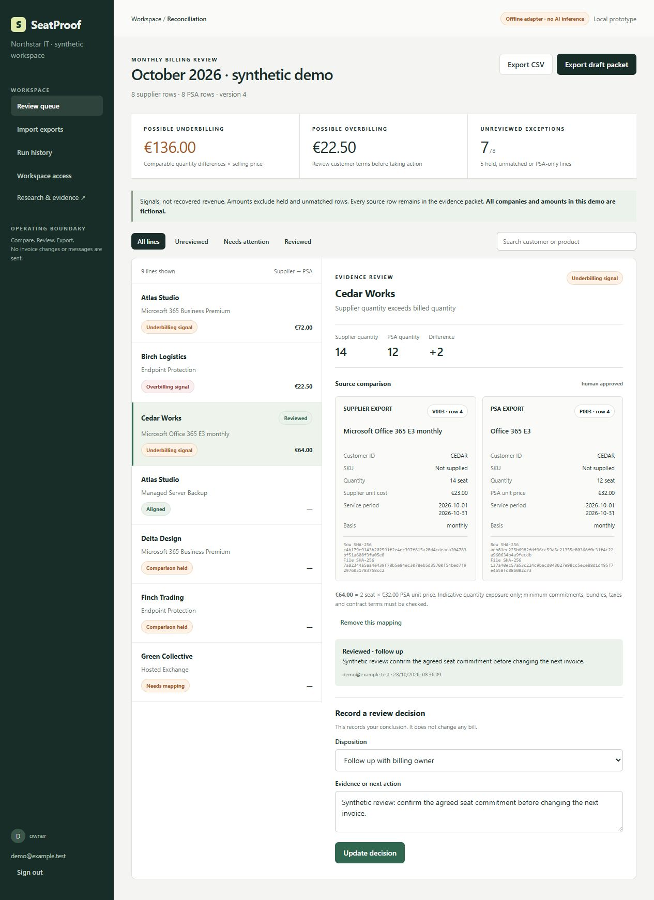

# SeatProof

**Preserved engineering prototype. Commercial development stopped: no compelling advantage over existing MSP reconciliation products was established.**

## Final commercial conclusion — 28 October 2026

**Recommendation: stop SeatProof as a standalone MSP reconciliation business.** Direct comparison with CloudOlive, Gradient Reconcile, BillRecon and BillingReconcile did not establish a customer problem that SeatProof solves adequately while those alternatives leave it inadequately solved. CSV ingestion, discrepancy detection, reviewer control and evidence-backed review already overlap competing products.

Local offline operation and a portable source-and-decision packet are implemented differences, but no observed customer workflow, paid commitment or comparative outcome establishes their commercial value. No evidence-backed commercial pivot or service-led repositioning was identified. The working implementation is preserved for engineering study and portfolio use; this is not a production-ready product or an active sales offer.

Read the [final competitive assessment and sources](COMMERCIAL_VERDICT.md). It supersedes the earlier pilot recommendation, pricing assumptions and go-to-market plans. Historical research and the application's `/research` page retain the original discovery record; they are not the current commercial recommendation. No additional product features were implemented for this conclusion.

Import supplier and PSA CSV exports → inspect every source row → review product-alias suggestions → approve mappings → reconcile comparable quantities → record decisions → export an evidence packet. Nothing updates invoices, sends messages or collects payments.



## What the research actually supports

The original discovery screened **32 problems**, retained **50 cited source records**, compared **seven opportunities**, and challenged three finalists. MSP billing has recurring practitioner pain and paid incumbents. No customer interviews, sales, paid pilots or differentiated willingness-to-pay evidence were obtained. The subsequent four-product comparison rejected the case for further commercial development. Category demand did not establish demand for SeatProof.

Start with [RESEARCH.md](RESEARCH.md), [EVIDENCE.md](EVIDENCE.md), [COMPETITIVE_ANALYSIS.md](COMPETITIVE_ANALYSIS.md), [OPPORTUNITY_SCORECARD.md](OPPORTUNITY_SCORECARD.md), and [BUSINESS_CASE.md](BUSINESS_CASE.md). The local `/research` page is a searchable visual dossier with sources and scoring.

## Run locally

Requires Node.js **24.x**. There are **no third-party runtime packages** and no install step is needed.

On Windows, double-click **Start-demo.cmd**, then open **http://127.0.0.1:4317**. Or from this directory:

```sh
npm run demo
```

Synthetic local demo credentials:

```text
demo@example.test
SeatProof-demo-2026
```

The demo binds only to loopback, uses `data/demo.sqlite`, and forces offline matching. Its credentials are intentionally public; use it only for fictional data. Saved demo changes persist. Close the terminal or press Ctrl+C to stop. If port 4317 is occupied, stop the previous instance or set `PORT` and use the printed URL.

For a separate private local workspace, stop the demo and run **Start-private-workspace.cmd** or:

```sh
npm start
```

Create your owner account in the browser; that database is `data/seatproof.sqlite`. Owners can create analyst/viewer accounts under Workspace access. No invitations are emailed. There is no password-recovery or account-revocation UI yet; do not use this build for sensitive production data.

## Demonstration and outputs

See [DEMO.md](DEMO.md). The supplied example has eight supplier rows and eight PSA rows. Initially it flags €72 possible underbilling and €22.50 possible overbilling. Human approval of the Cedar E3 mapping adds €64, giving **€136 and €22.50 respectively**. Three mismatched comparisons, one supplier-only line and one PSA-only line remain unquantified. These are fictional quantity exposures, not recovered revenue.

Reproducible output:

```sh
npm test
npm run evaluate
npm run demo:packet
```

Generated examples: [review packet](artifacts/demo-evidence-packet.json), [findings CSV](artifacts/demo-findings.csv), [evaluation](artifacts/evaluation.json). The packet includes original CSV strings, canonical row hashes, source file hashes, mappings, decisions, telemetry and hash-linked audit events. A reviewed packet means every exception has a disposition; follow-up work may still be outstanding.

## AI: implemented, bounded, honestly labelled

Default **offline-lexical** mode is deterministic token matching and is not LLM inference. The synthetic diagnostic set yields 23/24 correct decisions after fixes, with **one incorrect proposal**; no generalization claim follows. An exact-name baseline is more conservative. See [TEST_RESULTS.md](TEST_RESULTS.md), including the retained initial failures.

The real OpenAI Responses adapter is implemented with strict structured output, candidate retrieval, citation validation, refusal/timeout handling, usage estimates and mandatory human approval. It is **mock-tested, not live-validated**. No project API credential was supplied or sourced from other accounts.

To test live inference later, use the normal private server, explicitly set `SEATPROOF_AI_ENABLED=1` and an authorized `SEATPROOF_API_KEY` in the process environment, and confirm you may send product descriptions and row IDs to OpenAI. Do not commit keys. The app does not auto-load `.env`; `.env.example` documents settings. Default model: `gpt-4.1-mini-2025-04-14`. No automatic fallback from a failed live call to an offline success. Known pricing estimates apply only to that default snapshot.

## Input contract and limits

Use the headers in [samples/vendor.csv](samples/vendor.csv) and [samples/psa.csv](samples/psa.csv). Both exports must use the **same canonical customer IDs and, when populated, canonical SKUs**. The application does not convert real vendor-specific IDs or native PSA export columns automatically. That setup burden is a key commercial risk.

- UTF-8 CSV, comma delimiter, decimal dot, whole quantities, ISO dates, explicit unit and billing basis.
- At most 1,000 rows and 750 KB per file; 100,000 units and 100,000.00 unit price per row.
- Supported currency labels: EUR, USD, GBP, CAD, AUD. No FX conversion, tax calculations or combined cross-currency totals.
- Comparable basis: full calendar month, same period/currency/customer/unit, monthly seat/device/server units and positive unit prices.
- Credits, proration, bundles, metered usage, mismatched periods and duplicate service keys require manual handling. No split-line aggregation, OCR, PDF/XLSX import or PSA write-back.
- Suggestions do not establish that products, contractual minimums or billing rights are equivalent.

## Architecture and deployment

Node 24 HTTP server + native SQLite + browser ES modules. Server-side sessions and tenant-scoped queries; scrypt password hashes; role authorization; CSRF/origin checks; bounded inputs; CSP and escaped rendering. Details and limitations: [ARCHITECTURE.md](ARCHITECTURE.md), [SECURITY.md](SECURITY.md), [PRODUCT_SPEC.md](PRODUCT_SPEC.md).

`docker compose up --build` describes a single-node, loopback-only container deployment with persistent SQLite storage and a non-root process. **Docker execution remains unverified.** The repository is published; [GitHub Actions passed on Ubuntu with Node 24](https://github.com/hans992/SeatProof/actions/runs/40741774183), running the tests, synthetic evaluation and demo-packet generation against preserved commit `571f44e`. Public SaaS needs further identity, TLS, isolation, backup, deletion, monitoring and security work. This is not production-ready.

## Business and portfolio materials

[Go-to-market and 20 target criteria](GO_TO_MARKET.md) · [Interview protocol](INTERVIEW_PROTOCOL.md) · [Case study, AI summary, CV bullets and LinkedIn draft](PORTFOLIO.md) · [Prioritized next steps](NEXT_STEPS.md) · [Decisions](DECISIONS.md) · [Progress](PROGRESS.md).

The user authorized preservation in [hans992/SeatProof](https://github.com/hans992/SeatProof) together with the negative conclusion. No prospect outreach, purchases, payments or hosted product deployment occurred. See [preservation status and conditions for reconsideration](NEXT_STEPS.md); there is no active feature or sales roadmap.
